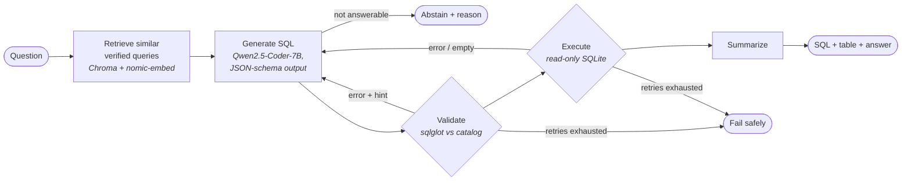

# PharmaSQL: an autonomous text-to-SQL agent for pharma commercial analytics

Ask a commercial question in plain English (*"What was Glucovia's share of the diabetes market
in the Northeast last quarter?"*) and get validated SQL, the result table, a chart and a
one-line answer in about 3 seconds, from an open-source LLM running **entirely on your own
machine**.

<!-- RESULTS_HEADLINE -->

## Demo walkthrough

```bash
uv run pharmasql ask "Which 5 territories had the lowest Glucovia quota attainment in 2026-Q3?"
```

```
WITH a AS (SELECT s.territory_id, SUM(s.net_sales) AS ns FROM fact_sales s ...
| territory_name | attainment_pct |
|---|---|
| Nashville | 88.4 | ...
╭─ answered ─────────────────────────────────────────────────────────────╮
│ Nashville had the lowest Glucovia quota attainment last quarter ...     │
╰─────────────────────────────────────────────────────────────────────────╯
retrieve_examples      28 ms
generate_sql         3412 ms  {'attempt': 1}
validate                9 ms
execute               210 ms  {'rows': 5}
summarize            1630 ms
```

The Streamlit app (`uv run pharmasql ui`) shows each agent step live as it runs. It has tabs
for the SQL, the result, an auto-chart and the full agent trace, plus a **👍 Save as verified
query** button that feeds the few-shot bank. It also includes a benchmark explorer and a
data-model browser. Ask *"What was our TV advertising spend?"* to see it **decline** rather
than invent a number.

## The agent loop



It is a **LangGraph** state machine, with every node timed into a trace:

| Node | What it does |
|---|---|
| **Semantic layer** (`config/semantic_layer.yaml`) | Business definitions injected into the prompt: *revenue = net sales*, *last quarter = 2026-Q3*, *market share = brand TRx / therapeutic-area TRx*, standard join paths, and the data's known limits. |
| **Dynamic few-shot** | Retrieves the 4 most similar question→SQL pairs from a verified-query bank (Chroma + `nomic-embed-text`). The bank grows from analyst feedback in the UI. |
| **Structured generation** | Ollama's JSON-schema constrained decoding returns `{reasoning, answerable, sql, assumptions}`. There's no regex-parsing of SQL out of markdown, and `answerable` lets the model refuse. |
| **Static validation** | sqlglot parses the SQL and checks it against the live catalog. It allows only a single read-only SELECT. It catches **hallucinated tables and columns** with a join-path hint (*"territory_id lives in dim_hcp; JOIN dim_hcp.hcp_id = fact_rx.hcp_id"*), **joins on unrelated keys**, and **integer division** (`SUM(int)/SUM(int)` = 0 in SQLite). |
| **Execution** | SQLite opened `mode=ro` with `PRAGMA query_only`, a wall-clock timeout and a row cap. |
| **Self-correction** | Validation or execution errors, and empty or all-NULL results, go back to the model with the exact message, up to 3 retries. An empty result can also lead to a correct **abstention** ("competitor revenue isn't in this data"). |

## The data

`uv run pharmasql generate-data` builds a deterministic (seed 42) **star schema** modelled on
pharma commercial data marts. Every company, brand, payer and person in it is fictional.

| Table | Rows | Contents |
|---|---:|---|
| `fact_rx` | 327k | Monthly TRx / NRx by HCP × brand × payer (IQVIA-style), all brands incl. competitors |
| `fact_sales` | 3.5k | Monthly units, gross and net sales by territory × own brand |
| `fact_call` | 17k | Rep calls on HCPs by channel (in-person / virtual / email) |
| `fact_quota` | 1.3k | Quarterly net-sales targets by territory × brand |
| `dim_hcp`, `dim_rep`, `dim_product`, `dim_payer`, `formulary`, `dim_territory`, `dim_region`, `dim_calendar` | | 1,200 HCPs (Luhn-valid NPIs), 50 reps, 11 brands in 5 therapeutic areas, 8 payers |

The data has real signal: a GLP-1-style brand growing from 31% to 51% share, an oncology
launch curve, respiratory seasonality, regional skews, formulary-driven payer mix,
gross-to-net by channel, and rep calls that lift prescribing over the next three months.

## Evaluation

`evals/benchmark.yaml` holds **80 questions with hand-verified gold SQL**: 20 easy, 25 medium,
20 hard (market share, growth, quota attainment, window functions, anti-joins) and **15
unanswerable** (patient-level data, competitor revenue, TV spend, weekly granularity, ...).

- **Execution accuracy:** predicted and gold SQL are both executed and their result sets
  compared. Row order is ignored, extra columns are allowed, and the numeric comparison is
  rounding-aware.
- **Hallucination** is measured two ways: SQL referencing non-existent schema, and answers
  given to unanswerable questions.
- **No leakage:** the few-shot bank and the benchmark are disjoint (a test enforces it), and
  every gold query is itself tested to be valid and non-empty.

<!-- RESULTS_TABLES -->

Full tables, charts and metric definitions: [`results/REPORT.md`](results/REPORT.md).
Per-question records (SQL, errors, attempts, latency, tokens): `results/runs/*.jsonl`.

<!-- ERROR_ANALYSIS -->

## Quickstart

Requirements: Python 3.11+, [uv](https://docs.astral.sh/uv/), [Ollama](https://ollama.com),
and about 6 GB of free VRAM (or patience on CPU).

```bash
uv sync                               # dependencies
ollama pull qwen2.5-coder:7b          # SQL model (4.7 GB)
ollama pull nomic-embed-text          # embeddings for few-shot retrieval
uv run pharmasql generate-data        # data/pharma.db (already included; regenerates identically)

uv run pharmasql ask "What was Glucovia's market share last quarter?"
uv run pharmasql ui                   # Streamlit app on http://localhost:8501
uv run pharmasql serve                # REST API, docs at http://127.0.0.1:8000/docs

uv run pytest                         # 151 offline tests, no LLM needed
uv run pharmasql eval --config all    # ablation study (~25 min on an 8 GB GPU)
uv run pharmasql report               # results/REPORT.md + charts
```

Settings can be overridden through `PHARMASQL_*` environment variables (see `.env.example`),
e.g. `PHARMASQL_SQL_MODEL=llama3.2:3b`.

## Project layout

```
src/pharmasql/
  agent/graph.py      LangGraph state machine (nodes, routing, retry budget)
  agent/prompts.py    prompt construction and repair feedback
  agent/llm.py        Ollama adapters behind small protocols (swappable, fakeable)
  agent/fewshot.py    verified-query bank + Chroma retrieval
  validator.py        sqlglot safety, schema-grounding, join and integer-division checks
  executor.py         read-only, time-boxed SQLite execution
  catalog.py          schema introspection, FK graph, join-path search
  semantic.py         semantic-layer model
  eval/               benchmark runner, result comparator, report builder
  data/               synthetic data generator + DDL
  api.py, cli.py      FastAPI service, Typer CLI
app/streamlit_app.py  analyst UI
config/               semantic layer, verified-query bank
evals/benchmark.yaml  80-question benchmark
tests/                offline suite with a scripted LLM
```

## Limitations and next steps

- A 7B local model is still weakest on multi-step questions (fan-out joins, ratio-of-ratios).
  The next levers are a result-sanity check (shares must sum to 100, totals reconcile to a
  control total), and LoRA fine-tuning once the verified-query bank is large.
- At warehouse scale (hundreds of tables), add schema linking: retrieve the relevant tables
  per question before generation.
- The benchmark is 80 questions on one schema, which is enough to compare configurations
  but not a general text-to-SQL claim.
